# FlipStack

FlipStack is a menu-bar print manager for printers that cannot turn a page over by themselves. It handles everyday single-sided jobs, guided manual duplex, and folded booklets from one quiet panel. It prints the fronts, guides you through turning the whole stack as one block, and prints the backs. Page order stays correct. Nothing is shuffled, and no page reversal is used.

FlipStack lives in the menu bar (and can also open as a normal resizable window), works with the printers already configured in macOS, and reads each queue's real PPD for the options that queue actually supports. If your printer can print one side at a time, FlipStack can help it print two.

## How the magic works

A manual duplex job is easy to get wrong: one sheet out of place and the document is unusable. FlipStack keeps the two passes deterministic and never guesses when a pass is finished. Single-sided jobs use the same print engine for one clean pass; duplex and booklet add the flip.

1. **Odd pages first, face-up.** FlipStack sends the odd pages as the first print pass. On a face-up output tray, the physical output is a stack whose printed sides face up.
2. **Flip the whole block.** When the first CUPS job really finishes, FlipStack asks you to pick up the entire stack, turn it over as one block, and reinsert it. Do not fan, sort, or reverse the sheets.
3. **Even pages second.** FlipStack sends the even pages as the second pass. Because you flipped the stack instead of reversing the pages in software, the backs land on the correct sheets in the correct order.

If the document has an odd page count, the last sheet's back stays blank; the flip prompt says so before you turn the stack.

The flip axis is configured once per printer:

| Flip axis | Typical use | CUPS value |
| --- | --- | --- |
| Long edge | Books, portrait documents | `Duplex=NoTumble` |
| Short edge | Calendars, landscape pages | `Duplex=Tumble` |

If your output tray already ejects pages face-down, FlipStack skips the physical flip and asks you to reinsert the stack unchanged. It still never reverses the page order.

There are no timer-based "the printer is probably done" transitions. FlipStack watches the CUPS job state and advances only when the queue reports completion, failure, cancellation, or a problem that needs your attention. While a job is printing, the progress ring shows a working sweep if the queue does not report page-level progress.

## Features

- **Everyday single-sided printing.** One clean pass for ordinary documents, envelopes, and labels, with copies, page ranges, and the same PPD-driven options.
- **Guided manual duplex.** Two passes, one clear flip prompt, and a state machine that keeps the document in order from start to finish.
- **Guided flip calibration.** On the first two-sided job, FlipStack opens a setup screen and prints one generic orientation sheet only after you confirm. Its answers become a saved flip axis and tray setting before the real document is sent. Re-run it from printer settings at any time.
- **PPD-driven options.** Color or black-and-white, paper size, media type, and print quality come from the queue's real PPD. FlipStack does not invent driver choices, and remembers the choices per printer.
- **Quality presets that actually apply.** Eco, Standard, High, and Photo resolve to real PPD choices for resolution, media, color, and optional ICC profile settings. Anything the driver does not expose stays untouched.
- **Layout and scale controls.** Match the PDF, portrait, or landscape; fit-to-page or an exact 50–150% print scale. The page dimensions, queue paper, exact percentage, color mode, and quality appear as a scannable summary right above the print action. Exact scaling is applied to a temporary PDF before submission; the preview updates with the scale.
- **Page picker with thumbnails.** Open the print preview to get a macOS Preview-style page rail. Every page starts selected; uncheck pages to print only the ones you want. The preview and the printed page ranges update together.
- **Four languages.** English, Italiano, Español, and Français can be chosen in Settings and apply immediately across the app. Driver-supplied paper/media names remain whatever the PPD advertises.
- **Tunable quality presets.** Settings exposes the real PPD quality and media choices behind Eco, Standard, High, and Photo for each printer, listed in true dpi order so every intermediate step the driver offers is visible. Tune once; your values persist per queue and apply the next time you choose that preset. You can also add your own named presets for mid-steps the built-ins do not cover.
- **Print preview.** See the selected pages inside the panel before printing, drawn like the macOS print panel: a fixed paper sheet (from the queue's real PPD paper size) with your page scaled, centered, and clipped inside it — "Fit" shows the page scaled to the paper exactly as CUPS `fit-to-page` will print it, and an exact percentage shows the cropping at the sheet edges. The setup card shows the same live sheet diagram next to the page and paper sizes. Booklet previews show each imposed 2-up sheet side, with fronts and backs one tap apart.
- **Page ranges done right.** Selected pages are compiled in order before the two-pass flow, so the sheet pairing stays correct even when the range starts on an even page. Ranges work in single-sided, duplex, and booklet modes.
- **Booklet imposition.** Two-up booklet printing with configurable signatures, plus fold and staple hints. Booklets use the same guided front-and-back workflow.
- **Live queue, ink, and errors.** See active and recent CUPS jobs, cancel a job, watch every supply the printer reports (including light cyan/light magenta/photo black), and read human-friendly state reasons. If a printer exposes no supply data, the panel says so instead of showing a fake level; the header also reports an offline device rather than pretending it is ready.
- **Detects nearby printers.** Configured CUPS queues plus `lpinfo` discovery for USB and Wi-Fi/network devices. Detected devices that are not yet queues can be set up from the panel in Printers & Scanners.
- **Test and alignment sheets.** Print a color and alignment test page, or a head-alignment reference, without leaving the app.
- **Color-managed and photo-ready where the driver allows it.** Select the PPD's own color profiles and use the Photo preset to pick photo media, maximum quality, color, and a driver profile.
- **A menu-bar workflow that stays out of the way.** A custom printer-and-paper flip scene, interactive notifications, and per-printer memory for the flip axis and output tray.
- **Accessible by design.** VoiceOver labels, Reduce Motion-aware animations, and full support for the system dark and light appearance.

## Screenshots

The screenshots below use a demo queue so no real document or printer data is shown.

### First-time setup

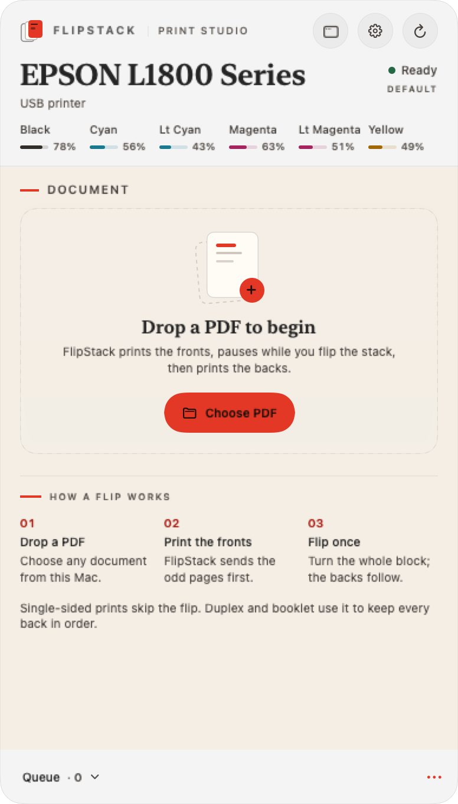

### A document ready to print

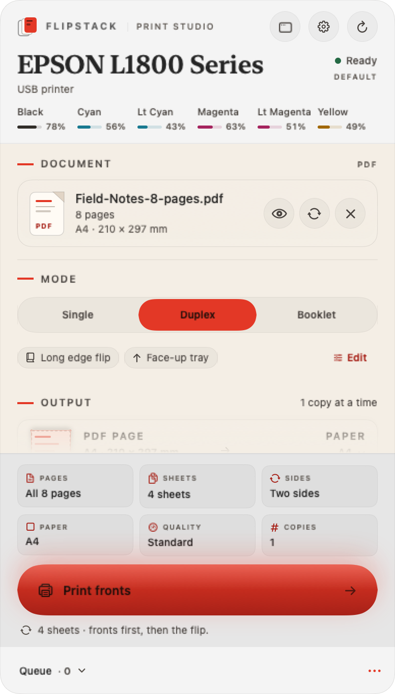

### Print preview and page picker

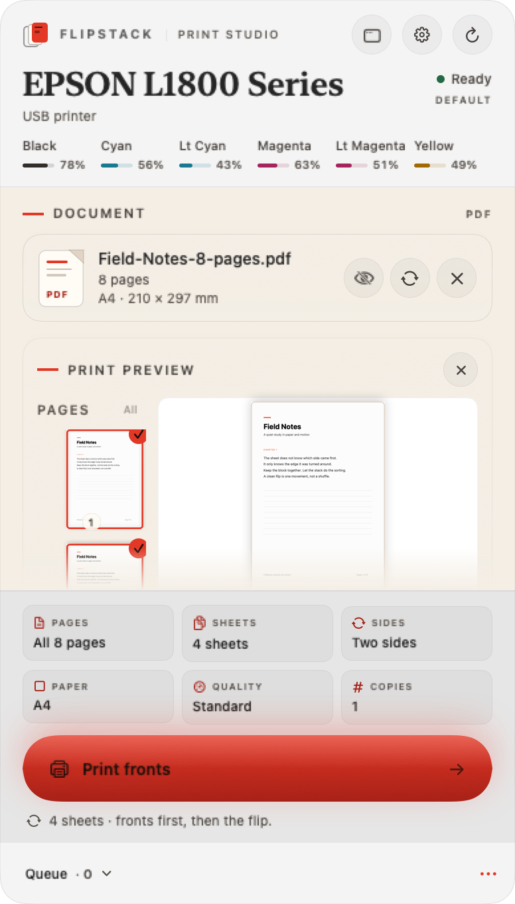

Uncheck pages in the rail to print only those pages; the selected-page PDF and the print job update together.

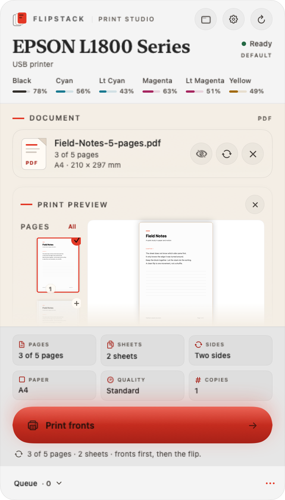

### Settings

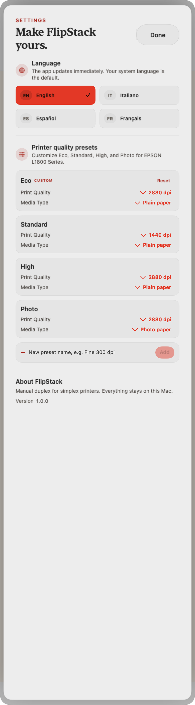

Choose the interface language and tune the real PPD values behind Eco, Standard, High, and Photo for the selected printer. Overrides are local and persist per queue. Quality choices are listed lowest-to-highest by their real dpi, and you can add your own named presets (for example a mid-step between Eco and High) with the Add row — each one maps only to choices the driver actually advertises. Settings opens as a sheet over the document, so your place is never lost.

### Calibrate the flip

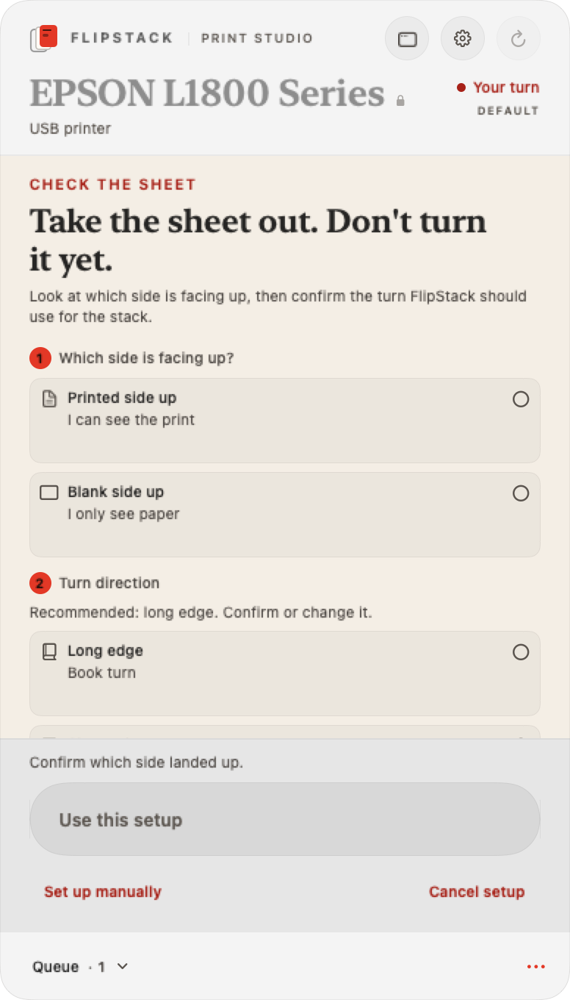

### Flip when the fronts are done

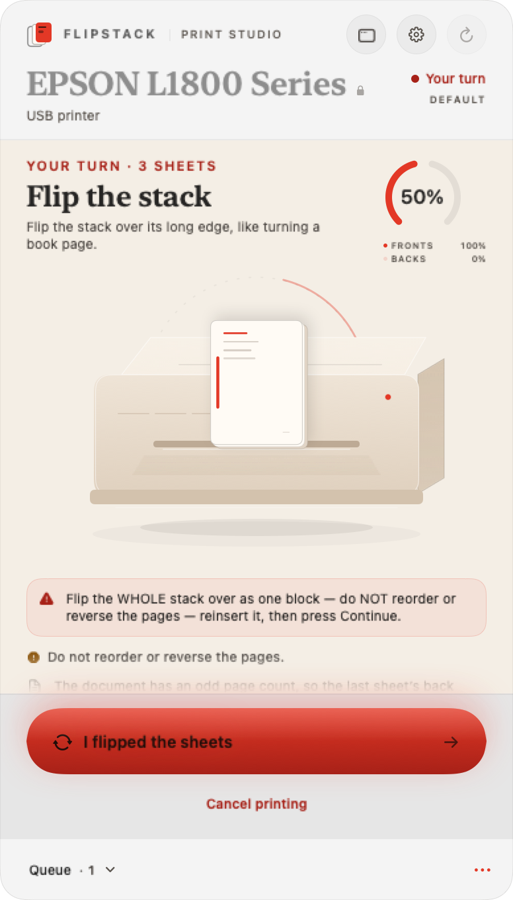

The whole two-sided flow — ready, fronts printing, flip, done — as a loop:

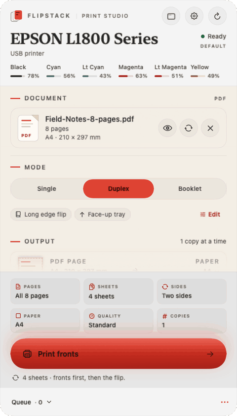

### Printing and progress

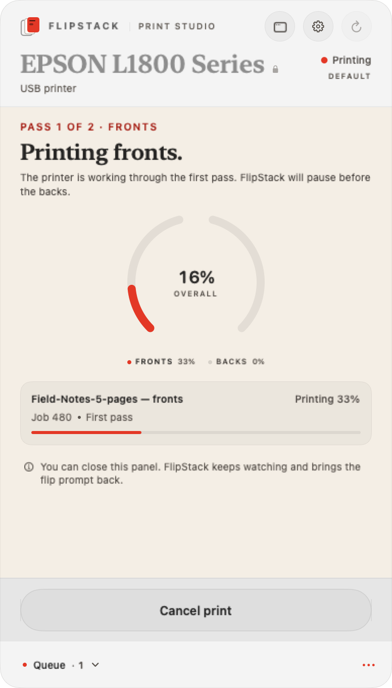

### Booklet planning

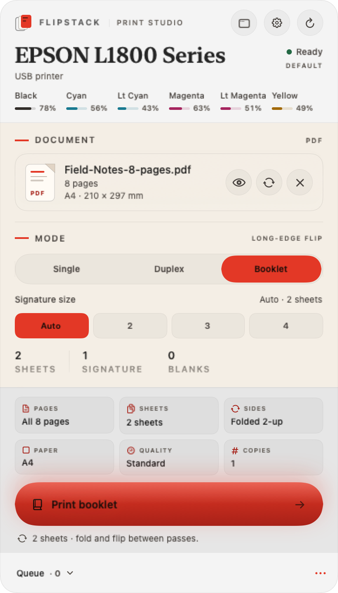

### Queue and printer health

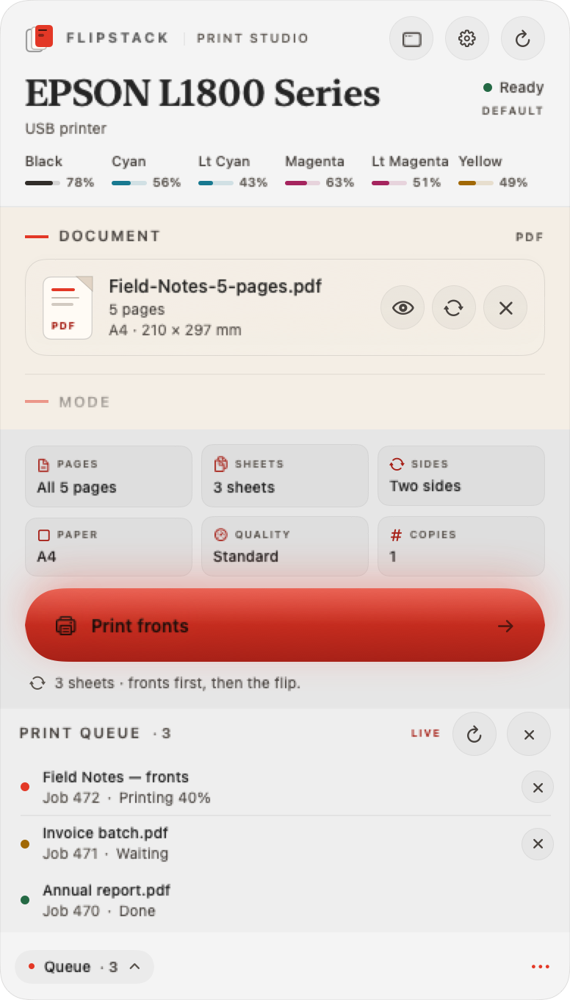

## Install

### Requirements

- macOS 13 Ventura or later
- An Apple silicon or Intel Mac
- A printer queue configured in **System Settings > Printers & Scanners**

### Install FlipStack

1. Download the notarized DMG from [the latest release](/releases/latest). Choose the `FlipStack-*.dmg` asset.
2. Open the DMG and drag **FlipStack.app** to **Applications**.
3. Launch FlipStack from Applications. Gatekeeper verifies the Developer ID signature and notarization.
4. On the first flip prompt, allow notifications if you want FlipStack to get your attention while another app is in front. Notifications are optional; the flip popover opens either way.
5. Use the FlipStack icon in the menu bar for the quick panel, or right-click it and choose **Open FlipStack Window** for the full window. The app does not keep a Dock icon while the window is closed. While a file is being dragged, the quick panel stays open and accepts the drop; clicking outside still dismisses it after the mouse button is released.

Release builds are universal: the same DMG runs natively on Apple silicon and Intel Macs.

## Privacy

FlipStack is local-only. There is no telemetry, analytics, account system, cloud sync, external crash reporting, or third-party SDK. Documents are not uploaded to any external service, stored in its own history, or included in notifications; they are sent only to the selected CUPS queue/printer for printing. Temporary print files live in the current user's protected temporary directory and are removed after use. CUPS job titles are generic, and the queue panel shows only jobs owned by the current user or submitted by this FlipStack session.

The network activity is limited to printing and printer discovery: a print job to the configured CUPS queue, local CUPS/IPP status, CUPS `lpinfo` discovery that may generate local network/mDNS traffic, optional read-only SNMP supply queries to a configured network printer, and status requests to a remote CUPS host only if `CUPS_SERVER` explicitly points there. CUPS itself may retain job metadata/history independently of FlipStack.

The calibration sheet is generic and contains no document content. Read [PRIVACY.md](PRIVACY.md) for the full data-handling statement and local data removal instructions.

## Why not the Mac App Store

FlipStack is distributed directly, outside the Mac App Store. The App Sandbox blocks the parts of macOS that a print manager needs:

- Access to local CUPS queues and print jobs
- The `lp`, `lpstat`, and `cancel` command-line interface used by CUPS
- PPD files under `/etc/cups/ppd` and `/Library/Printers/PPDs`

Sandboxing those capabilities would break the core workflow. FlipStack is therefore built as a hardened-runtime app, signed with a Developer ID certificate, and notarized by Apple for direct distribution. There is no App Store version planned.

## Build from source

You need macOS 13 or later and Xcode 15 or later with Swift 5.9 or later. FlipStack has no third-party dependencies.

```sh
swift build
swift test
Scripts/bundle.sh
open dist/FlipStack.app
```

`Scripts/bundle.sh` builds a release app bundle, copies the versioned `Info.plist`, generates the app icon if needed, and ad-hoc signs the result for local use. It prints the path of the app and, when requested, the DMG.

Useful variations:

```sh
# Build a universal app for Apple silicon and Intel
BUILD_ARCHS="arm64 x86_64" Scripts/bundle.sh

# Override the version written into Info.plist
MARKETING_VERSION=1.0.1 BUILD_NUMBER=42 Scripts/bundle.sh

# Also create a DMG
Scripts/bundle.sh --dmg

# Sign with the first installed Developer ID Application certificate
CODESIGN_IDENTITY="$(security find-identity -v -p codesigning \
  | sed -n 's/.*"\(Developer ID Application: .*\)"/\1/p' \
  | head -n 1)" Scripts/bundle.sh
```

Unsigned or ad-hoc builds are for local development only. The release workflow requires Apple notarization credentials and is intended for maintainers.

## Usage

1. Click the FlipStack icon in the menu bar.
2. Choose a printer from the queue list.
3. Drop a PDF onto the panel, or press Command-O.
4. Choose **Single**, **Duplex**, or **Booklet**. Select any driver options and set the number of copies.
5. Choose **All** pages or enter a range such as `1-4, 7`.
6. Press the print button. FlipStack sends the fronts first (or the only pass for single-sided).
7. When the flip prompt appears, take the whole stack, flip it as instructed, reinsert it, and press **Continue**.
8. Watch the second pass and the queue from the same panel.

The first time you print a two-sided job on a given printer, FlipStack opens a guided setup screen. The generic orientation sheet prints only after you press **Print setup sheet**. The sheet uses the queue's current paper and media and contains no document content. It asks which side landed facing up, recommends a long-edge turn for portrait/book-style documents or a short-edge turn for landscape/calendar-style documents, and waits for both answers to be confirmed. The real document waits until you save the calibration. You can cancel into manual setup instead, and both paths are saved for that printer. Re-run calibration or print a standalone orientation sheet later from the printer settings. Single-sided jobs do not need this setup.

Booklet mode pads the document to a multiple of four pages, imposes two pages per side, and supports signatures for longer documents. FlipStack uses the long-edge flip for booklets and shows the fold and staple instructions after the sheets are printed.

For two-sided jobs, FlipStack prints one copy at a time so every back lands on its matching front. To print several copies, print another after the first completes. Single-sided jobs can print up to 20 copies in one job. Page ranges are compiled in order before printing: the two-pass flow always alternates front and back from the first selected page, even when the range starts on an even page.

Use the eye button on the document row to open the inline print preview. The preview has the same compact scale stepper and color/black-and-white control so the page updates live; for booklets, switch between fronts and backs to inspect the actual 2-up sheet sides. For single-sided and duplex jobs, the page rail on the left shows a thumbnail of every source page. Check or uncheck pages to choose exactly what prints; the range above and the job both follow that selection. Close the preview to return to the print controls.

Quality presets are applied to the real driver choices. Eco avoids the absolute lowest draft resolution when a choice at or above 300 dpi exists, so it stays light without looking like a fax; Standard picks the balanced option; High picks the best non-photo quality; Photo uses maximum quality, photo media, and the driver's photo/ICC profile when present. Quality and color are independent: choosing a preset while B&W is active keeps B&W, and the preset stays selected. Choose a preset, or fine-tune paper, media, and quality; the preset indicator shows Custom when the current combination does not match. Orientation, fit-to-page or exact scale, and color mode are applied to both passes. Exact scale is baked into a temporary PDF before submission. The preview reflects the selected scale and color mode.

Open **Settings** from the maintenance menu, the app menu (`⌘,`), or the right-click menu. The Language section switches the whole interface and app menus immediately. The printer section shows the selected queue's real PPD quality and media values for each preset; changes are stored only on this Mac, per printer, and reset individually with **Reset**.

### Settings that are remembered

FlipStack saves the following per printer:

- The selected PPD choices: color mode, paper size, media type, quality/resolution, and any driver color profiles.
- The quality preset is derived from those choices, so the last effective preset is restored.
- Layout: Match PDF/portrait/landscape orientation, fit-to-page or exact scale, and the selected color/black-and-white PPD choice.
- The physical flip axis, the face-down output-tray setting, and whether setup has been completed, including a calibration result.
- The last selected printer and the last print mode (single, duplex, or booklet).

The page range and copy count belong to the current job and are intentionally not restored on the next launch. Two-sided jobs always print one copy at a time; single-sided jobs can use up to 20 copies.

### Compared with the macOS print dialog

FlipStack is better for its specific job: it keeps manual duplex page order explicit, previews the actual selected pages (including booklet 2-up sides), keeps driver choices discoverable instead of hiding them behind generic presets, remembers per-printer calibration and layout, and exposes the real CUPS queue and job state.

It is not a system-wide replacement for every macOS print feature. It prints through configured CUPS queues, does not auto-create queues for discovered devices, does not use hardware automatic duplex for two-sided work, and only offers vendor-specific features that the queue's PPD exposes. Specialty printer languages, input ICC profile conversion, and automatic multiple-copy manual-duplex batching are outside this version.

Keyboard shortcuts: Command-O opens a PDF, Command-P starts the current job, Command-R refreshes printers and queues.

## Printer compatibility

FlipStack prints through standard CUPS queues, so it works with USB, Wi-Fi/Bonjour, Ethernet, IPP Everywhere/AirPrint and other network queues that macOS can print to. The printer picker lists configured queues and also scans `lpinfo` for nearby USB and network devices that have not been added yet; use **Set up** to add one in Printers & Scanners.

Driver options are read from the queue's real PPD. Generic or driverless queues without a PPD still print with system defaults, but vendor-specific quality and color choices only appear when the driver exposes them. See [docs/PRINTER-COMPATIBILITY.md](docs/PRINTER-COMPATIBILITY.md) for the detailed compatibility matrix, preset mapping, connection notes, and limitations.

## PPD support and limits

FlipStack uses the print queue's real PPD. It looks for the queue's PPD in `/etc/cups/ppd/` first, then in `/Library/Printers/PPDs`.

- Driver options are shown only when the PPD defines them. Labels and values come from the PPD; FlipStack does not make up media types, resolutions, color modes, or profiles.
- Quality presets (Eco, Standard, High, Photo) are resolved against real PPD choices. If a driver exposes only some capability groups, the preset applies what exists and leaves the rest alone.
- Color profiles appear when the driver exposes profile choices. The Photo preset selects the best available photo media, highest photo quality, color mode, and profile. A driver without profiles does not get a fabricated one.
- If no PPD is found, or the PPD cannot be read, the app falls back to the system defaults for that queue. Manual duplex still works because the two passes use CUPS page sets; quality presets are not offered because there are no real driver choices to map.
- Ink levels and detailed state reasons appear only when the printer or driver exposes them. Supply levels use IPP first, with an SNMP fallback when the queue advertises an SNMP-capable network device. A missing ink reading does not prevent printing.
- The Epson L1800 is a simplex printer. FlipStack treats it as a manual duplex target and never pretends that the printer has automatic duplex hardware.
- Some drivers ignore the `Duplex` value on a simplex queue. The physical two-pass workflow still applies; the value is sent so drivers that understand the axis can use it consistently.

## Troubleshooting

### The job is in CUPS, but nothing prints

Check that the queue is enabled and not paused:

```sh
lpstat -p -d
lpstat -o
```

Open **System Settings > Printers & Scanners** and clear any paused or stopped state. If another job is ahead of yours, FlipStack waits for it and reports the queue state.

### A job is stuck

Open the queue in FlipStack and cancel the job, or cancel it by ID:

```sh
cancel 42
```

Replace `42` with the job ID from the queue. Then press **Start over** in FlipStack before printing again. **Retry backs** appears only when the second pass failed before it could print, such as when the printer refused the job; it reuses the intact stack without reprinting the fronts. If any back pages may already have printed, start over so no sheet is printed twice.

### The flip prompt does not appear

The prompt appears only after CUPS reports the first job as completed. If the printer is paused, out of paper, or showing an error, clear it and FlipStack will continue monitoring. The flip popover is independent of notifications and opens when the app needs you.

### No flip notification

FlipStack may ask for notification permission the first time a flip is required. If you dismissed or denied that request, enable notifications in **System Settings > Notifications > FlipStack**. Notifications are a convenience; the menu-bar popover remains the primary prompt.

### No ink data

Not every printer reports supply levels over IPP or SNMP. If the panel says that live status is unavailable, the queue and print flow still work. Driver-specific ink reporting is outside FlipStack's control.

### The backs are upside down or the page order is wrong

Check the two per-printer settings first: **Flip axis** and **Output tray ejects face-down**. The face-down setting is the first thing to check. Run a short two-page or four-page document, verify the stack orientation, and keep the sheets together as one block between passes. Do not reverse the stack to correct an individual sheet.

### The app will not open

Download the DMG from the latest GitHub Release rather than moving a local development build. Release builds are notarized. If macOS still blocks the app, confirm that it is in `/Applications` and check **System Settings > Privacy & Security** for the Gatekeeper message.

## Architecture

FlipStack is a Swift package with a thin AppKit/SwiftUI shell and a testable core:

```text
FlipStack (menu-bar app, SwiftUI, AppKit)
                 |
          FlipStackCore
   Models | CUPS | PPD | Status | Compatibility | Duplex | Imposition
```

| Module | Responsibility |
| --- | --- |
| `Sources/FlipStack` | Menu-bar quick panel, optional normal window, SwiftUI views, AppKit window behavior, notifications, per-printer preferences |
| `Sources/FlipStackCore/Models` | Printer, job, PPD, duplex, and booklet value types; the manual-duplex state model |
| `Sources/FlipStackCore/Status` | IPP and SNMP printer status, state reasons, and supplies |
| `Sources/FlipStackCore/Compatibility` | Quality presets and PPD color/profile mapping |
| `Sources/FlipStackCore/CUPS` | CUPS discovery, job submission, monitoring, cancellation, and `lpinfo` device discovery |
| `Sources/FlipStackCore/PPD` | PPD discovery and parsing |
| `Sources/FlipStackCore/Duplex` | The two-pass orchestration and job-state transitions |
| `Sources/FlipStackCore/Imposition` | Two-up booklet planning and PDF imposition |

The core is UI-independent and uses protocols for the print spooler, PPD provider, and status provider. That keeps the duplex state machine and imposition code testable without a physical printer. See [docs/ARCHITECTURE.md](docs/ARCHITECTURE.md) for the detailed design.

## Testing

```sh
swift test
swift test --parallel
```

The tests live in `Tests/FlipStackCoreTests` and use injected fakes instead of a real print queue. PPD fixtures are kept under `Tests/FlipStackCoreTests/Fixtures/PPDs` and are copied by SwiftPM as test resources. The test suite covers page ordering, single-sided sequencing, page-range extraction, flip-axis handling, face-down reinsertion, booklet signatures, PPD parsing, job-state transitions, and status parsing.

Hardware behavior still needs a real printer. The contribution guide describes what to verify when changing the print path.

## Contributing

Contributions are welcome. Read [CONTRIBUTING.md](CONTRIBUTING.md) for the build and test commands, fixture rules, style expectations, and the pull request checklist. Hardware reports are especially useful when they include the printer model, connection type, PPD, and output-tray behavior, with personal details removed.

## License

FlipStack is released under the [MIT License](LICENSE).

Copyright (c) 2026 FlipStack contributors.

## Acknowledgments

FlipStack is built on the Common UNIX Printing System (CUPS) for queue discovery, job submission, and status; Apple PDFKit for PDF handling; and SwiftUI and AppKit for the interface. Thanks to the CUPS and OpenPrinting communities, and to everyone who tests manual duplex on real hardware.

Epson and L1800 are trademarks of Seiko Epson Corporation. FlipStack is an independent project and is not affiliated with or endorsed by Epson or Apple.
