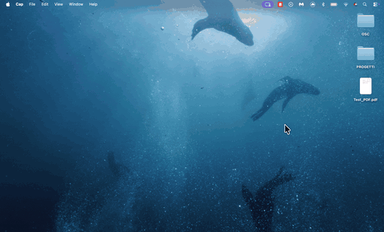

# FlipStack

FlipStack is a tiny macOS menu-bar app that adds **guided two-sided (manual
duplex) printing** to any printer that can only print one side at a time.
Drop a document, print the fronts, flip the whole stack once when asked, and the
backs print in the correct order. No shuffling, no page reversal, no guesswork.

<p align="center">
  
</p>

**Download:** <https://abla25.github.io/flipstack-website/> — macOS 14+, Apple
silicon. The build is **ad-hoc signed, not notarized**: on first launch
right-click the app → **Open** (macOS 15+ also offers System Settings →
Privacy & Security → **Open Anyway**).

## What ships

The app released as `FlipStack.app` (current release **v1.0.3, build 14**) is the
receipt-style menu-bar app in [`Demo/`](Demo/). It is the product users download;
everything else in the repository is the engine, history or the unshipped root
app.

- **Guided manual duplex** — fronts, one flip (long/short edge diagram), backs.
  Cancel/retry anywhere; real CUPS job state is watched, no timers.
- **Live preview** — fit-to-page sheet, page slider, choose exactly which pages
  print.
- **Honest printer status** — Bonjour + TCP probes tell whether a network
  printer is really on; real ink levels from the queue.
- **Lossless photos** — JPEG embedded bit-exact; HEIC/PNG/PDF/DOCX accepted.
- **English + Italiano** — switchable in Settings, applied immediately.
- **Local only** — no accounts, no telemetry; documents go only to your printer.
- **Open source** — MIT, Swift + SwiftUI.

## Repository layout

| Path | What it is |
| --- | --- |
| `Demo/` | **The shipped app** (receipt UI, v1.0.3 / build 14). Standalone SwiftPM package depending on the root `FlipStackCore`. `Scripts/bundle-demo.sh` builds `dist-demo/FlipStack.app`, the DMG and the sha256. |
| `Sources/FlipStackCore` | The shared print engine: CUPS client, duplex orchestration, PPD parsing, page extraction/scaling, photo/document ingest. Used by the Demo (and by the root app). |
| `Sources/FlipStack` | The earlier minimal root app. Built, tested and bundled in CI, but **not** the shipped product. |
| `Advanced/` | The previous feature-rich version, preserved in full as a standalone package. Not shipped. |
| `Scripts/bundle-demo.sh` | Build + assemble + ad-hoc sign + optional DMG/sha256 for **the shipped Demo app**. |
| `Scripts/bundle.sh` | Builds the root app bundle (universal/notarized plumbing used by the old release workflow). Not used for Demo releases. |
| `Resources/`, `Tests/` | Root app resources and the engine test suite (250 tests). |
| `docs/` | Screenshots and the demo GIF used here and on the website. |

## Build and test

The Demo (shipped app) — macOS 14+, Xcode command line tools:

```sh
cd Demo
swift build -c release
swift test                       # 96 tests
```

Root package (engine + root app):

```sh
swift build
swift test                       # 250 tests (1 live-CUPS test skips without a reachable printer)
```

The preserved advanced version:

```sh
cd Advanced && swift build && swift test
```

> In a restricted/agent sandbox the SwiftPM sandbox may be unavailable; append
> `--disable-sandbox` to `swift build`/`swift test` there. A normal Terminal
> build does not need it.

## Package, install, uninstall

Build the shipped app and package it exactly as released:

```sh
Scripts/bundle-demo.sh --dmg
# dist-demo/FlipStack.app
# dist-demo/FlipStack.dmg          (UDZO, volume "FlipStack", /Applications symlink)
# dist-demo/FlipStack.dmg.sha256
```

Install (quit the old instance first):

```sh
osascript -e 'quit app "FlipStack"' || true
rm -rf /Applications/FlipStack.app
ditto dist-demo/FlipStack.app /Applications/FlipStack.app
open /Applications/FlipStack.app
```

Uninstall: quit the app (menu-bar icon → Quit) and move
`/Applications/FlipStack.app` to the Trash. No login items or daemons are
installed. Preferences and the Local Network permission stay behind until you
remove them explicitly:

```sh
defaults delete app.flipstack.FlipStack          # reset all settings for this app
tccutil reset All app.flipstack.FlipStack        # reset TCC grants (may need Full Disk Access)
```

**Never change the bundle identifier** `app.flipstack.FlipStack`: it is the
prefs domain, the Local Network TCC key and the LaunchServices identity.
Changing it would wipe the user's settings and printer history. The Demo
namespaces its own preferences under `FlipStack.demo.*` so they never collide
with the older root app's `FlipStack.*` keys.

## Release process

The canonical release is built **locally on a maintainer Mac** (there are no
Apple Developer secrets in CI, so notarization is not possible):

1. **Bump the version** in [`Demo/version.env`](Demo/version.env)
   (`MARKETING_VERSION`, `BUILD_NUMBER`). That file is the single source of
   truth: `Scripts/bundle-demo.sh` renders it into the bundle's `Info.plist`,
   which the app reads for its in-app version label. No source edits needed.
2. **Build, sign, package:**
   `Scripts/bundle-demo.sh --dmg` (add `--universal` if Intel Macs must be
   supported; the release is arm64-only by default).
3. **Verify:** plist version/build, `codesign --verify --deep --strict`,
   mount the DMG, `shasum -a 256 -c dist-demo/FlipStack.dmg.sha256`, and run
   the headless smoke test (`dist-demo/FlipStack.app/Contents/MacOS/FlipStack
   --capture /tmp/verify.png --state settings --quit-after 2`).
4. **Commit + tag:** commit the version bump/docs, push `main`, then
   `git tag -a vX.Y.Z -m "FlipStack X.Y.Z (build N)"` and
   `git push origin vX.Y.Z`. Tags do **not** publish anything by themselves.
5. **Publish the GitHub release** with assets named **exactly**
   `FlipStack.dmg` and `FlipStack.dmg.sha256` (the website links
   `releases/latest/download/FlipStack.dmg`, and GitHub's `latest` is the
   newest non-draft, non-prerelease release):

   ```sh
   gh release create vX.Y.Z --verify-tag \
     --title "FlipStack X.Y.Z (build N)" --notes-file release-notes.md \
     dist-demo/FlipStack.dmg dist-demo/FlipStack.dmg.sha256
   ```

   A draft-first flow (`gh release create --draft` → `gh release upload` →
   `gh release edit --draft=false`) keeps the public link on the previous
   version until everything is verified.
6. **Update the website** (`~/Desktop/flipstack-site`, private repo
   `Abla25/flipstack-website`, Pages at
   <https://abla25.github.io/flipstack-website/>): version labels in
   `index.html` and the `FlipStack.dmg.sha256` file. Push `main`; GitHub Pages
   redeploys automatically.

The `Release` workflow in this repository is **manual-only**
(`workflow_dispatch`): it re-runs the same Demo build/tests on a clean GitHub
runner, uploads the DMG + sha256 as workflow artifacts and never creates or
publishes a GitHub release.

## Known limitations

- **Ad-hoc signed, not notarized** (no Apple Developer account). Gatekeeper
  asks for right-click → Open on first launch; `spctl` reports "rejected" by
  design.
- **arm64-only** by default. `Scripts/bundle-demo.sh --universal` builds
  arm64 + x86_64 for Intel Macs.
- **macOS 14+** — the Demo package targets macOS 14 (`LSMinimumSystemVersion`),
  and uses modern SwiftUI/AppKit APIs.
- **No auto-update** — updates are manual downloads of the new DMG.
- **Not sandboxed** — the app runs `lpstat`/`lp`/`lpoptions` and probes printers
  on the local network; macOS shows a Local Network permission prompt on first
  printer status refresh.

## Privacy

No telemetry, no accounts, no cloud. Documents are converted locally and sent
only to the selected CUPS queue. Temporary files live in a per-user
`0700`/`0600` directory and are removed after use. See [`PRIVACY.md`](PRIVACY.md).

## License

MIT — see [`LICENSE`](LICENSE).
