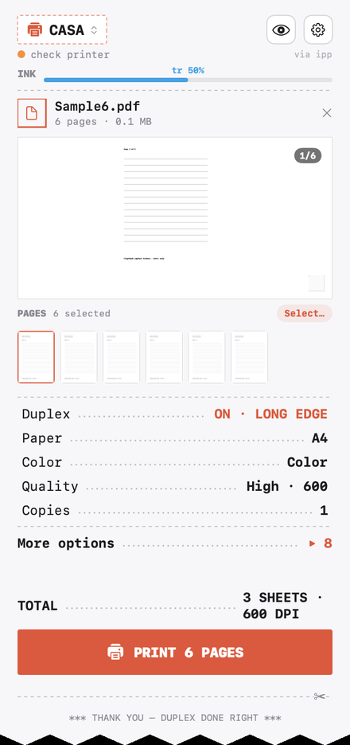
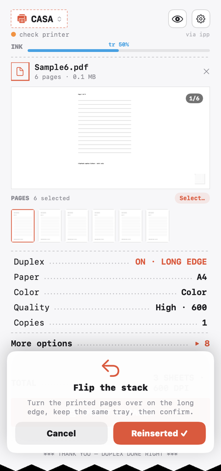
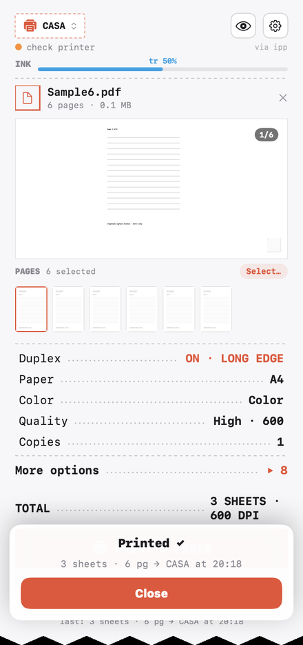

# FlipStack

FlipStack is a menu-bar print manager that adds **guided two-sided (duplex) printing** to any printer that can only print one side at a time — which is most home and office printers.

The main application is deliberately minimal: **one workflow, done well.** Drop a file, optionally adjust print settings, press print. FlipStack prints the fronts, asks you to flip the whole stack once, then prints the backs in the correct order. No shuffling, no page reversal, no guesswork.

## Repository structure

| Path | What it is |
| --- | --- |
| `Sources/FlipStack` | **The main application** — the lightweight, duplex-focused version described below. |
| `Sources/FlipStackCore` | The shared print engine (CUPS client, duplex orchestrator, PPD parsing, page extraction/scaling, photo/document ingest). |
| `Advanced/` | **The previous, feature-rich version**, preserved in full as a standalone Swift package. It adds booklet imposition, an in-panel print preview with a page-picker rail, the queue and ink-level view, tunable and custom quality presets, and more. Nothing was deleted; see `Advanced/README.md`. Features from there may be reintroduced into the main app over time when they prove meaningful. |

## The main workflow

1. **Drop a file.** Drag any PDF, photo (JPEG, HEIC, PNG, TIFF, … — embedded at full native resolution, never recompressed), or Word/text document onto the panel, or use **Choose files** / <kbd>Cmd</kbd>+<kbd>O</kbd>. Multiple files print as one job.
2. **Print settings (optional).** A collapsed **Print settings** row keeps everything configurable — pages, paper, media, orientation, scale/fit, color, quality — without competing with the main action. The current choices are summarized right on the row.
3. **Print fronts.** One coral button starts the job. FlipStack watches the real CUPS job state — no timers, no guesses.
4. **Flip once, backs print.** When the fronts really finish, the panel asks you to turn the whole stack as one block and press **I flipped the sheets**. The backs then print on the correct sheets in the correct order. If your tray ejects face-down, it asks you to reinsert instead.

## First-time calibration

On the first two-sided job with a printer, FlipStack prints **one generic orientation sheet** (no document content) and asks two questions — which side landed up, and which way you turn the stack. The answers become a saved per-printer flip-axis and tray setting. Re-run it any time from the menu. The calibration implementation is shared with the advanced version and works exactly the same.

## Details

- **PPD-driven options.** Paper, media, color mode, and quality come from the queue's real PPD — FlipStack never invents driver choices — and are remembered per printer.
- **Fit or exact scale.** Fit-to-page (CUPS `fit-to-page`) or an exact 50–150% scale applied to a temporary PDF before submission.
- **Page ranges.** `All` or a typed range like `1–4, 7`; ranges start correctly even on an even page because selected pages are compiled in order before the two-pass split.
- **Live status.** The header shows printer health; while a pass runs, the panel shows live job progress.
- **Four languages.** English, Italiano, Español, Français — switchable in Settings, applied immediately.
- **Local-only.** No telemetry, no accounts, no cloud. Documents are converted locally (photos are embedded bit-exact/lossless) and sent only to the selected CUPS queue. Temporary files live in a per-user `0700`/`0600` directory and are removed after use. See `PRIVACY.md`.
- **Accessible.** VoiceOver labels throughout, Reduce Motion-aware animations, full dark/light appearance support.

## Build and run

```sh
swift build
swift run FlipStack        # menu-bar app; right-click the icon for a window
```

Release bundles: `Scripts/bundle.sh --dmg` (ad-hoc locally; the signed/notarized release comes from the GitHub Actions release workflow on `v*` tags).

Tests: `swift test` — 248 tests covering the engine (CUPS option building, duplex orchestration, imposition, PPD parsing, ingest, security regressions).

## Screenshots

<p align="center">
  
  
  
</p>

Live site with download: **https://abla25.github.io/flipstack-website/** · Source: this repo.

The full feature set and screenshots of the previous interface are in [`Advanced/`](Advanced/README.md) (`Advanced/docs/screenshots/`).
